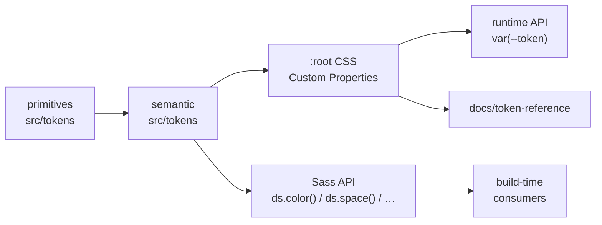

# ds-base — Architecture

```
ds-base
│
├── src/                  # Design System core (public API)
│   ├── tokens/           # primitives → semantic → brand slots
│   ├── functions/        # ds.color, ds.space, ds.font-size, …
│   ├── mixins/           # ds.mq, ds.rounded, ds.text-style, …
│   ├── base/             # reset + :root Custom Properties
│   ├── helpers/          # ds-* utility classes
│   ├── fonts/            # @font-face generator (local/remote)
│   └── icons/            # icon contract (.ds-icon) only
│
├── adapters/             # optional integrations (never auto-imported)
│   ├── icons/            # icon providers (bootstrap/)
│   └── liferay/          # Clay / Style Book / fragments bridge
│
├── docs/
│   └── token-reference/  # visual reference + token smoke test
│
└── dist/                 # generated artifacts (gitignored)
```

Token flow:



Rules:

- `src/` never imports `adapters/` or `docs/`.
- Adapters are opt-in: `@use ".../adapters/..."`.
- Generated output (`dist/`, `docs/token-reference/ds-base.css`)
  is never a source of truth — always rebuild from SCSS.
